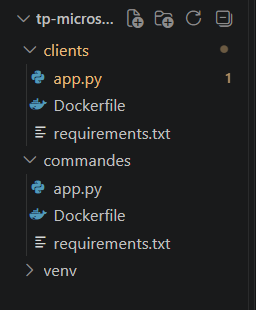
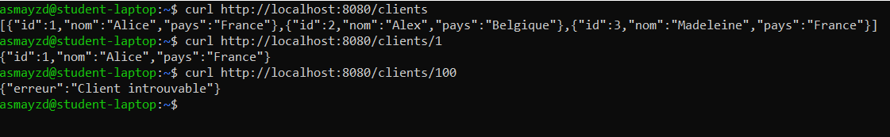
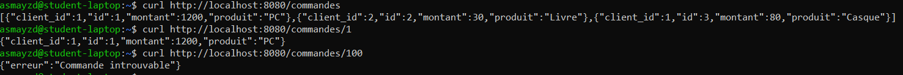
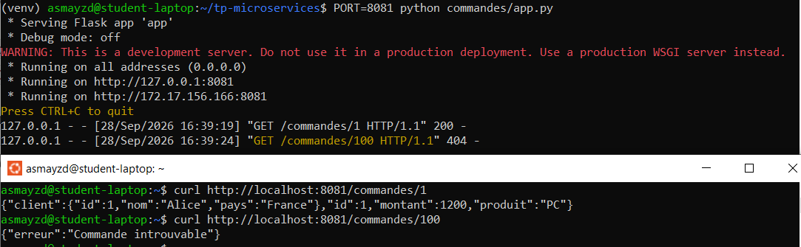
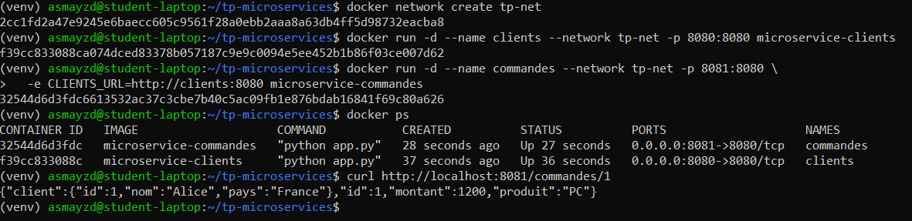
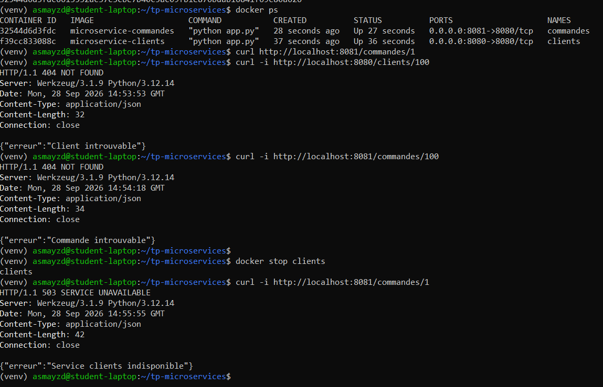

# TP1 – Communication entre microservices (API REST)

## 1.1 Architecture

L'application contient deux microservices Python (Flask), chacun dans son propre conteneur Docker. Les deux conteneurs sont sur le même réseau Docker, `tp-net`.

Le service clients gère les clients et répond sur `/clients` et `/clients/<id>`. Le service commandes gère les commandes et répond sur `/commandes` et `/commandes/<id>`. Quand on demande une commande, il appelle clients en HTTP pour récupérer les infos du client, puis renvoie la commande complétée.

La communication est synchrone : commandes attend la réponse de clients avant de répondre. Si clients ne répond pas, commandes renvoie une erreur.

```
utilisateur                                utilisateur
     |                                          |
     | localhost:8081                           | localhost:8080
     v                                          v
[ commandes ] ---- GET /clients/<id> ----> [ clients ]
              <------ infos du client -----

         (les deux conteneurs sont sur tp-net)
```

## 1.2 Création du projet

On a créé l'arborescence demandée. Le dossier `venv` sert seulement à tester en local, il ne fait pas partie du rendu.



Le service clients n'appelle aucun autre service, donc son `requirements.txt` contient seulement :

```
flask
```

## 1.3 API REST du microservice Clients

Le serveur Flask écoute sur le port 8080. On a mis `host="0.0.0.0"` pour qu'il soit accessible depuis l'extérieur du conteneur plus tard. Si l'id demandé n'existe pas, on renvoie une erreur 404.

clients/app.py :

```python
from flask import Flask, jsonify

app = Flask(__name__)

clients = [
    {"id": 1, "nom": "Alice", "pays": "France"},
    {"id": 2, "nom": "Alex", "pays": "Belgique"},
    {"id": 3, "nom": "Madeleine", "pays": "France"}
]

@app.route("/clients", methods=["GET"])
def get_clients():
    return jsonify(clients)

@app.route("/clients/<int:client_id>", methods=["GET"])
def get_client(client_id):
    for client in clients:
        if client["id"] == client_id:
            return jsonify(client)
    return jsonify({"erreur": "Client introuvable"}), 404

if __name__ == "__main__":
    app.run(host="0.0.0.0", port=8080)
```

Tests en local :

```bash
curl http://localhost:8080/clients
curl http://localhost:8080/clients/1
curl http://localhost:8080/clients/100
```



## 1.4 API REST du microservice Commandes

Même principe que pour clients : un serveur Flask sur le port 8080 avec les trois commandes du sujet, et les routes `/commandes` et `/commandes/<id>`. Une commande qui n'existe pas renvoie une 404. À cette étape, commandes n'appelle pas encore clients. Le code final est donné en 1.5.

Tests en local :

```bash
curl http://localhost:8080/commandes
curl http://localhost:8080/commandes/1
curl http://localhost:8080/commandes/100
```



## 1.5 Communication entre les microservices

Pour `GET /commandes/<id>`, commandes cherche la commande, prend son `client_id` et appelle clients avec `requests`. Il renvoie ensuite la commande avec les infos du client dedans.

L'adresse de clients est lue dans la variable d'environnement `CLIENTS_URL`. En local c'est `http://localhost:8080`, et dans Docker ce sera `http://clients:8080`. On a fait pareil pour le port avec `PORT`, pour pouvoir lancer les deux services en même temps en local.

commandes/requirements.txt :

```
flask
requests
```

commandes/app.py :

```python
import os
import requests
from flask import Flask, jsonify

app = Flask(__name__)

CLIENTS_URL = os.environ.get("CLIENTS_URL", "http://localhost:8080")

commandes = [
    {"id": 1, "client_id": 1, "produit": "PC", "montant": 1200},
    {"id": 2, "client_id": 2, "produit": "Livre", "montant": 30},
    {"id": 3, "client_id": 1, "produit": "Casque", "montant": 80}
]

@app.route("/commandes", methods=["GET"])
def get_commandes():
    return jsonify(commandes)

@app.route("/commandes/<int:commande_id>", methods=["GET"])
def get_commande(commande_id):
    commande = next((c for c in commandes if c["id"] == commande_id), None)
    if commande is None:
        return jsonify({"erreur": "Commande introuvable"}), 404

    # appel au service clients
    try:
        r = requests.get(f"{CLIENTS_URL}/clients/{commande['client_id']}", timeout=3)
    except requests.exceptions.RequestException:
        return jsonify({"erreur": "Service clients indisponible"}), 503

    if r.status_code == 404:
        return jsonify({"erreur": "Client introuvable"}), 404

    return jsonify({
        "id": commande["id"],
        "produit": commande["produit"],
        "montant": commande["montant"],
        "client": r.json()
    })

if __name__ == "__main__":
    port = int(os.environ.get("PORT", 8080))
    app.run(host="0.0.0.0", port=port)
```

Test en local, avec clients sur 8080 et commandes sur 8081 :

```bash
python clients/app.py
PORT=8081 python commandes/app.py
curl http://localhost:8081/commandes/1
```

On obtient bien la commande avec les infos d'Alice :

```json
{"client":{"id":1,"nom":"Alice","pays":"France"},"id":1,"montant":1200,"produit":"PC"}
```



## 2.1 Dockerisation et réseau Docker

On utilise le même Dockerfile pour les deux services (dans `clients/` et dans `commandes/`) :

```dockerfile
FROM python:3.12-slim
WORKDIR /app
COPY requirements.txt .
RUN pip install --no-cache-dir -r requirements.txt
COPY app.py .
EXPOSE 8080
CMD ["python", "app.py"]
```

Construction des images :

```bash
docker build -t microservice-clients ./clients
docker build -t microservice-commandes ./commandes
```

Création du réseau et lancement des conteneurs :

```bash
docker network create tp-net

docker run -d --name clients --network tp-net -p 8080:8080 microservice-clients

docker run -d --name commandes --network tp-net -p 8081:8080 \
  -e CLIENTS_URL=http://clients:8080 microservice-commandes
```

Nos choix :

- On a créé un réseau `tp-net` pour que les conteneurs puissent se trouver par leur nom. Sur le réseau par défaut de Docker, ça ne marche pas.
- Les deux services écoutent sur 8080 dans leur conteneur. Sur la machine, on a gardé 8080 pour clients et mis 8081 pour commandes, sinon les deux ports seraient en conflit.
- Commandes appelle clients avec `http://clients:8080`, donc le nom du conteneur et son port interne. On ne peut pas utiliser `localhost` ici, car dans un conteneur ça désigne le conteneur lui-même.

Vérification :

```bash
docker ps
curl http://localhost:8081/commandes/1
```



## 2.2 Gestion des erreurs

Les trois cas demandés sont gérés dans le code. On les a testés avec les conteneurs lancés, en ajoutant `-i` à curl pour voir le code HTTP.

- Client inexistant : `curl -i http://localhost:8080/clients/100` renvoie 404 avec "Client introuvable".
- Commande inexistante : `curl -i http://localhost:8081/commandes/100` renvoie 404 avec "Commande introuvable".
- Service clients arrêté : après `docker stop clients`, `curl -i http://localhost:8081/commandes/1` renvoie 503 avec "Service clients indisponible".

Dans le dernier cas, on renvoie une 503 et pas une 500, parce que ce n'est pas commandes qui plante mais le service dont il a besoin. Le `timeout=3` évite aussi que commandes reste bloqué si clients ne répond plus. On voit bien ici la limite d'une communication synchrone : si clients tombe, commandes ne peut plus répondre correctement.



## 3. Commandes Docker utilisées

Toutes les commandes sont lancées depuis le dossier `tp-microservices/`.

```bash
# images
docker build -t microservice-clients ./clients
docker build -t microservice-commandes ./commandes

# réseau
docker network create tp-net

# conteneurs
docker run -d --name clients --network tp-net -p 8080:8080 microservice-clients
docker run -d --name commandes --network tp-net -p 8081:8080 \
  -e CLIENTS_URL=http://clients:8080 microservice-commandes

# vérification
docker ps

# tests
curl http://localhost:8080/clients
curl http://localhost:8081/commandes/1
curl -i http://localhost:8080/clients/100
curl -i http://localhost:8081/commandes/100

# panne du service clients
docker stop clients
curl -i http://localhost:8081/commandes/1
docker start clients
```
