# TP2 - Communication entre microservices avec Kafka

Le sujet mentionne Spring Boot, mais on a gardé Python (Flask) et la bibliothèque `kafka-python` pour rester cohérent avec le TP1 et le TP3, qui sont en Python.

## 1.1 Architecture

Dans ce TP, commandes n'appelle plus clients directement. Les deux services passent par Kafka et ne se connaissent pas.

- **commandes** expose une API REST avec `POST /commandes`. Quand une commande est créée, il publie un événement dans le topic `commandes-creees` et répond tout de suite, sans attendre.
- **Kafka** reçoit les événements et les garde dans le topic. Ils restent disponibles même si aucun consommateur n'est lancé.
- **clients** garde son API REST (`GET /clients`) et lit en parallèle les événements du topic. Il affiche chaque commande reçue et compte le nombre de commandes par client.
- **statistiques** (ajouté en 1.7) lit aussi le topic et calcule le nombre de commandes par produit et le chiffre d'affaires par mois.

Tous les services tournent dans des conteneurs Docker, lancés avec un seul `docker-compose.yml`.

```
utilisateur
     |
     | POST /commandes (port 8081)
     v
[ commandes ] --- publie un événement ---> [ Kafka ]
                                          topic : commandes-creees
                                                |
                                  +-------------+-------------+
                                  |                           |
                                  v                           v
                            [ clients ]                [ statistiques ]
                            port 8080                   port 8082
                     (compteur par client)      (stats produits / mois)
```

## 1.2 Principe d'un événement

Un événement décrit quelque chose qui s'est passé, ici "une commande a été créée". Quand commandes reçoit une nouvelle commande, il envoie dans le topic `commandes-creees` un message JSON de ce type :

```json
{
  "commande_id": 10,
  "client_id": 2,
  "produit": "PC",
  "montant": 1200
}
```

Au TP1, commandes demandait quelque chose à clients et attendait sa réponse. Ici, commandes publie l'événement sans savoir qui va le lire. Tout service abonné au topic peut le consommer quand il est disponible.

## 1.3 Installation de Kafka avec Docker

Kafka tourne dans un conteneur, avec l'image officielle `apache/kafka` en mode KRaft. Dans ce mode, Kafka gère lui-même son cluster sans Zookeeper, donc un seul conteneur suffit.

Kafka écoute sur deux adresses :

- `kafka:9092` pour les autres conteneurs, sur le réseau créé par Docker Compose ;
- `localhost:9094` depuis la machine, pour les tests.

Les facteurs de réplication sont mis à 1 car on n'a qu'un seul broker. `KAFKA_NUM_PARTITIONS: 2` donne 2 partitions par défaut aux topics, ce qui sert pour la question 8.

Partie Kafka du `docker-compose.yml` (le fichier complet est donné à la fin) :

```yaml
services:
  kafka:
    image: apache/kafka:3.8.0
    container_name: kafka
    ports:
      - "9094:9094"
    environment:
      KAFKA_NODE_ID: 1
      KAFKA_PROCESS_ROLES: broker,controller
      KAFKA_LISTENERS: INTERNAL://:9092,EXTERNAL://:9094,CONTROLLER://:9093
      KAFKA_ADVERTISED_LISTENERS: INTERNAL://kafka:9092,EXTERNAL://localhost:9094
      KAFKA_LISTENER_SECURITY_PROTOCOL_MAP: INTERNAL:PLAINTEXT,EXTERNAL:PLAINTEXT,CONTROLLER:PLAINTEXT
      KAFKA_INTER_BROKER_LISTENER_NAME: INTERNAL
      KAFKA_CONTROLLER_LISTENER_NAMES: CONTROLLER
      KAFKA_CONTROLLER_QUORUM_VOTERS: 1@kafka:9093
      KAFKA_OFFSETS_TOPIC_REPLICATION_FACTOR: 1
      KAFKA_TRANSACTION_STATE_LOG_REPLICATION_FACTOR: 1
      KAFKA_TRANSACTION_STATE_LOG_MIN_ISR: 1
      KAFKA_NUM_PARTITIONS: 2
```

Démarrage, vérification et création du topic :

```bash
docker compose up -d
docker ps
docker logs kafka | tail -5

docker exec kafka /opt/kafka/bin/kafka-topics.sh --create \
  --topic commandes-creees --partitions 2 --replication-factor 1 \
  --bootstrap-server localhost:9092

docker exec kafka /opt/kafka/bin/kafka-topics.sh --describe \
  --topic commandes-creees --bootstrap-server localhost:9092
```

Le conteneur kafka tourne, Kafka a bien démarré, et le topic a ses 2 partitions :

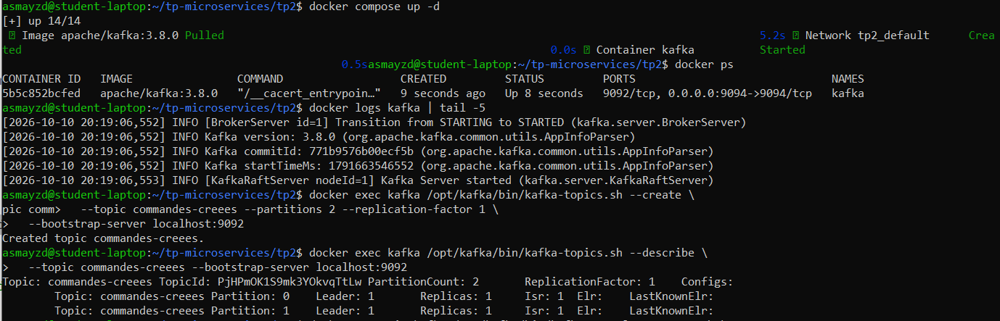

On a ensuite vérifié que Kafka transporte bien les messages avec les outils fournis dans le conteneur : un message envoyé avec `kafka-console-producer.sh` arrive bien dans `kafka-console-consumer.sh`.

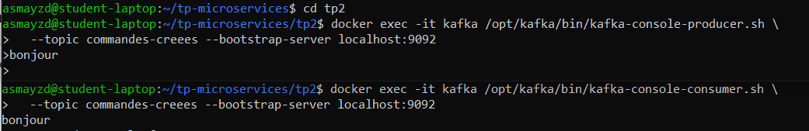

## 1.4 Création du producteur commandes Kafka

Dépendances (`commandes/requirements.txt`) :

```
flask
kafka-python>=2.0.3
```

On n'a plus besoin de `requests` puisque commandes n'appelle plus clients. La version 2.0.3 minimum de `kafka-python` est nécessaire avec Python 3.12.

Ce qui est demandé par le sujet :

- **Connexion au broker** : `KafkaProducer(bootstrap_servers=...)`. L'adresse vient de la variable `KAFKA_BOOTSTRAP` (`kafka:9092` dans Docker). Si Kafka n'est pas encore prêt au démarrage, on réessaie toutes les 3 secondes.
- **Topic utilisé** : `commandes-creees`.
- **Structure du message** : le JSON du sujet (`commande_id`, `client_id`, `produit`, `montant`), plus une `date` ajoutée en 1.7. Le `value_serializer` transforme le dictionnaire en JSON puis en octets.
- **Envoi depuis l'API REST** : la route `POST /commandes` crée la commande puis appelle `producer.send()`. On utilise `client_id` comme clé, donc les commandes d'un même client vont toujours dans la même partition.

`commandes/app.py` (version finale, avec la date de la 1.7) :

```python
import os
import json
import time
from datetime import date
from flask import Flask, jsonify, request
from kafka import KafkaProducer

app = Flask(__name__)

KAFKA_BOOTSTRAP = os.environ.get("KAFKA_BOOTSTRAP", "localhost:9094")
TOPIC = "commandes-creees"

commandes = [
    {"id": 1, "client_id": 1, "produit": "PC", "montant": 1200},
    {"id": 2, "client_id": 2, "produit": "Livre", "montant": 30},
    {"id": 3, "client_id": 1, "produit": "Casque", "montant": 80}
]

# connexion au broker (on réessaie tant que Kafka n'est pas prêt)
def creer_producteur():
    while True:
        try:
            return KafkaProducer(
                bootstrap_servers=KAFKA_BOOTSTRAP,
                key_serializer=lambda k: str(k).encode("utf-8"),
                value_serializer=lambda v: json.dumps(v).encode("utf-8")
            )
        except Exception as e:
            print("Kafka pas encore disponible, nouvel essai dans 3 s...", e, flush=True)
            time.sleep(3)

producer = creer_producteur()

@app.route("/commandes", methods=["GET"])
def get_commandes():
    return jsonify(commandes)

@app.route("/commandes/<int:commande_id>", methods=["GET"])
def get_commande(commande_id):
    for c in commandes:
        if c["id"] == commande_id:
            return jsonify(c)
    return jsonify({"erreur": "Commande introuvable"}), 404

@app.route("/commandes", methods=["POST"])
def creer_commande():
    data = request.get_json()
    if not data or not all(k in data for k in ("client_id", "produit", "montant")):
        return jsonify({"erreur": "client_id, produit et montant sont obligatoires"}), 400

    commande = {
        "id": len(commandes) + 1,
        "client_id": data["client_id"],
        "produit": data["produit"],
        "montant": data["montant"],
        "date": data.get("date", date.today().isoformat())
    }
    commandes.append(commande)

    # événement envoyé dans Kafka
    evenement = {
        "commande_id": commande["id"],
        "client_id": commande["client_id"],
        "produit": commande["produit"],
        "montant": commande["montant"],
        "date": commande["date"]
    }
    producer.send(TOPIC, key=commande["client_id"], value=evenement)
    producer.flush()
    print("Evenement publie :", evenement, flush=True)

    return jsonify(commande), 201

if __name__ == "__main__":
    port = int(os.environ.get("PORT", 8080))
    app.run(host="0.0.0.0", port=port)
```

Publication d'une commande :

```bash
curl -X POST http://localhost:8081/commandes -H "Content-Type: application/json" \
  -d '{"client_id": 2, "produit": "PC", "montant": 1200}'
```

La commande est créée et l'événement JSON arrive bien dans le topic (on le voit avec le consommateur console) :

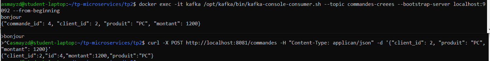

## 1.5 Création du consommateur clients Kafka

Le service clients garde son API REST et lit en même temps le topic. Comme `KafkaConsumer` attend les messages en boucle, on le lance dans un thread séparé pour ne pas bloquer Flask.

Points importants :

- `group_id="clients-group"` : Kafka retient pour ce groupe jusqu'où il a lu (l'offset).
- `auto_offset_reset="earliest"` : au premier démarrage, on lit le topic depuis le début.
- Les messages qui ne sont pas du JSON (comme le "bonjour" du test) sont ignorés.
- On affiche aussi la partition et l'offset de chaque message pour observer ce qui se passe.

`clients/requirements.txt` :

```
flask
kafka-python>=2.0.3
```

`clients/app.py` :

```python
import os
import json
import time
import threading
from flask import Flask, jsonify
from kafka import KafkaConsumer

app = Flask(__name__)

KAFKA_BOOTSTRAP = os.environ.get("KAFKA_BOOTSTRAP", "localhost:9094")
TOPIC = "commandes-creees"
GROUP_ID = os.environ.get("GROUP_ID", "clients-group")

clients = [
    {"id": 1, "nom": "Alice", "pays": "France"},
    {"id": 2, "nom": "Alex", "pays": "Belgique"},
    {"id": 3, "nom": "Madeleine", "pays": "France"}
]

# nombre de commandes par client
compteur = {}

def nom_client(client_id):
    for c in clients:
        if c["id"] == client_id:
            return c["nom"]
    return f"client inconnu ({client_id})"

def creer_consommateur():
    while True:
        try:
            return KafkaConsumer(
                TOPIC,
                bootstrap_servers=KAFKA_BOOTSTRAP,
                group_id=GROUP_ID,
                auto_offset_reset="earliest"
            )
        except Exception as e:
            print("Kafka pas encore disponible, nouvel essai dans 3 s...", e, flush=True)
            time.sleep(3)

def ecouter_kafka():
    consumer = creer_consommateur()
    print(f"Consommateur connecte (groupe {GROUP_ID})", flush=True)
    for message in consumer:
        try:
            evt = json.loads(message.value.decode("utf-8"))
        except (json.JSONDecodeError, UnicodeDecodeError):
            print("Message ignore (pas du JSON) :", message.value, flush=True)
            continue

        client_id = evt["client_id"]
        compteur[client_id] = compteur.get(client_id, 0) + 1

        print(f"[partition {message.partition}, offset {message.offset}] "
              f"Client : {nom_client(client_id)} | Produit : {evt['produit']} | "
              f"Montant : {evt['montant']}", flush=True)
        print("Commandes par client :",
              {nom_client(k): v for k, v in compteur.items()}, flush=True)

@app.route("/clients", methods=["GET"])
def get_clients():
    return jsonify(clients)

@app.route("/clients/<int:client_id>", methods=["GET"])
def get_client(client_id):
    for c in clients:
        if c["id"] == client_id:
            return jsonify(c)
    return jsonify({"erreur": "Client introuvable"}), 404

@app.route("/clients/compteurs", methods=["GET"])
def get_compteurs():
    return jsonify({nom_client(k): v for k, v in compteur.items()})

if __name__ == "__main__":
    threading.Thread(target=ecouter_kafka, daemon=True).start()
    port = int(os.environ.get("PORT", 8080))
    app.run(host="0.0.0.0", port=port)
```

Après plusieurs commandes, clients affiche chaque commande reçue (client, produit, montant) et le nombre de commandes par client. On voit aussi que les commandes d'Alex vont dans la partition 0 et celles d'Alice et Madeleine dans la partition 1, à cause de la clé `client_id`.

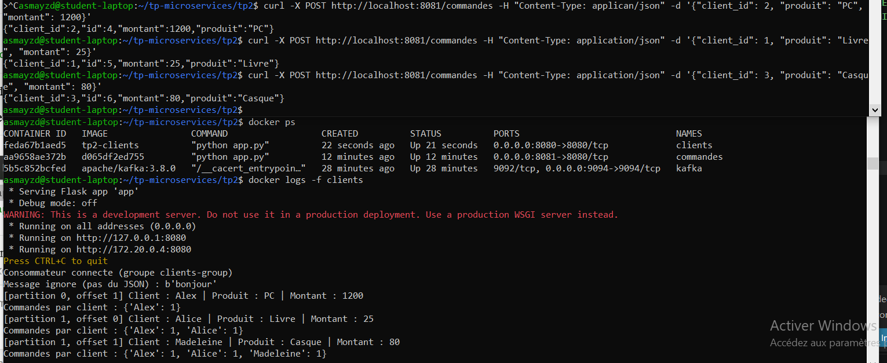

Le compteur est aussi disponible avec `GET /clients/compteurs` :

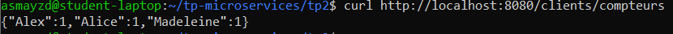

## 1.6 Arrêter un microservice

On a arrêté clients, puis créé deux commandes (Clavier et Ecran) :

```bash
docker stop clients
docker ps
curl -X POST http://localhost:8081/commandes -H "Content-Type: application/json" \
  -d '{"client_id": 2, "produit": "Clavier", "montant": 45}'
curl -X POST http://localhost:8081/commandes -H "Content-Type: application/json" \
  -d '{"client_id": 3, "produit": "Ecran", "montant": 200}'
```

Les commandes sont créées normalement : commandes ne dépend plus de clients. Au TP1, la même situation donnait une erreur 503.

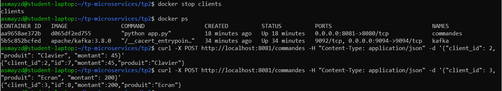

On a regardé l'état du groupe `clients-group` :

```bash
docker exec kafka /opt/kafka/bin/kafka-consumer-groups.sh --describe \
  --group clients-group --bootstrap-server localhost:9092
```

Le groupe n'a plus de membre actif, et la colonne LAG vaut 1 sur chaque partition : les 2 commandes sont stockées dans Kafka et attendent d'être lues.

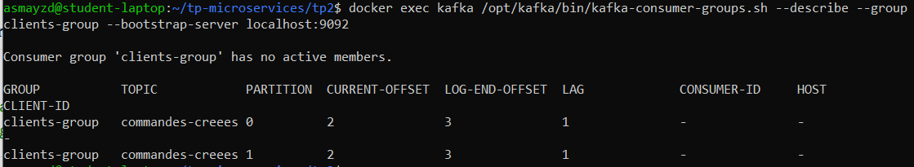

Après `docker start clients`, le service lit uniquement les deux commandes manquées (Ecran et Clavier), sans relire les anciennes. Le LAG revient à 0.

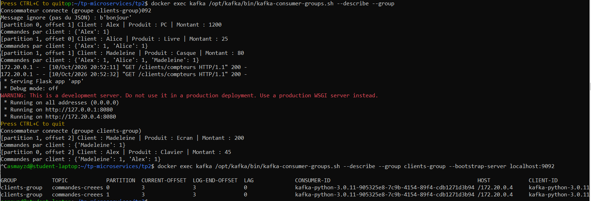

**Les événements ont-ils été perdus ?** Non. Kafka garde les messages dans le topic même sans consommateur, et il retient l'offset du groupe `clients-group`. Au redémarrage, clients reprend juste après le dernier message lu.

Par contre, le compteur repart de zéro (`{'Madeleine': 1, 'Alex': 1}`). Ce n'est pas Kafka qui perd quelque chose : le compteur est une variable en mémoire, perdue quand le conteneur s'arrête. Pour le garder, il faudrait l'enregistrer dans une base de données ou relire tout le topic au démarrage.

## 1.7 Ajouter un deuxième consommateur

On a créé un troisième microservice, statistiques, qui lit aussi le topic `commandes-creees` dans son propre groupe (`statistiques-group`). Il calcule :

- le nombre de commandes pour un produit donné : `GET /stats/produits/<produit>` ;
- le chiffre d'affaires pour un mois donné : `GET /stats/mois/<AAAA-MM>`.

Pour le chiffre d'affaires par mois, il fallait une date dans les événements. On a donc ajouté un champ `date` dans commandes (voir le code en 1.4). Par défaut c'est la date du jour, mais on peut la donner dans la requête pour tester plusieurs mois. Les anciens événements sans date sont rangés dans "sans date".

Le Dockerfile et le `requirements.txt` sont les mêmes que pour clients.

`statistiques/app.py` :

```python
import os
import json
import time
import threading
from flask import Flask, jsonify
from kafka import KafkaConsumer

app = Flask(__name__)

KAFKA_BOOTSTRAP = os.environ.get("KAFKA_BOOTSTRAP", "localhost:9094")
TOPIC = "commandes-creees"
GROUP_ID = os.environ.get("GROUP_ID", "statistiques-group")

commandes_par_produit = {}
ca_par_mois = {}

def creer_consommateur():
    while True:
        try:
            return KafkaConsumer(
                TOPIC,
                bootstrap_servers=KAFKA_BOOTSTRAP,
                group_id=GROUP_ID,
                auto_offset_reset="earliest"
            )
        except Exception as e:
            print("Kafka pas encore disponible, nouvel essai dans 3 s...", e, flush=True)
            time.sleep(3)

def ecouter_kafka():
    consumer = creer_consommateur()
    print(f"Consommateur connecte (groupe {GROUP_ID})", flush=True)
    for message in consumer:
        try:
            evt = json.loads(message.value.decode("utf-8"))
        except (json.JSONDecodeError, UnicodeDecodeError):
            print("Message ignore (pas du JSON) :", message.value, flush=True)
            continue

        produit = evt["produit"]
        commandes_par_produit[produit] = commandes_par_produit.get(produit, 0) + 1

        # les anciens événements n'ont pas de date
        mois = evt["date"][:7] if "date" in evt else "sans date"
        ca_par_mois[mois] = ca_par_mois.get(mois, 0) + evt["montant"]

        print(f"[partition {message.partition}, offset {message.offset}] "
              f"{produit} | {evt['montant']} | mois : {mois}", flush=True)
        print("Commandes par produit :", commandes_par_produit, flush=True)
        print("CA par mois :", ca_par_mois, flush=True)

@app.route("/stats/produits/<produit>", methods=["GET"])
def stats_produit(produit):
    return jsonify({"produit": produit,
                    "nombre_commandes": commandes_par_produit.get(produit, 0)})

@app.route("/stats/mois/<mois>", methods=["GET"])
def stats_mois(mois):
    return jsonify({"mois": mois, "chiffre_affaires": ca_par_mois.get(mois, 0)})

@app.route("/stats", methods=["GET"])
def stats():
    return jsonify({"commandes_par_produit": commandes_par_produit,
                    "ca_par_mois": ca_par_mois})

if __name__ == "__main__":
    threading.Thread(target=ecouter_kafka, daemon=True).start()
    port = int(os.environ.get("PORT", 8080))
    app.run(host="0.0.0.0", port=port)
```

Les quatre conteneurs tournent :

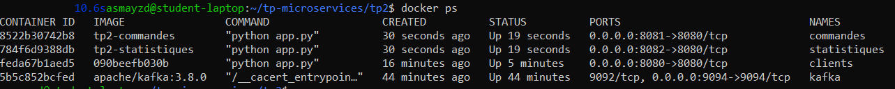

On a envoyé des commandes sur deux mois différents, puis interrogé statistiques :

```bash
curl -X POST http://localhost:8081/commandes -H "Content-Type: application/json" \
  -d '{"client_id": 1, "produit": "PC", "montant": 1000, "date": "2026-09-15"}'
curl -X POST http://localhost:8081/commandes -H "Content-Type: application/json" \
  -d '{"client_id": 2, "produit": "PC", "montant": 900, "date": "2026-10-02"}'
curl -X POST http://localhost:8081/commandes -H "Content-Type: application/json" \
  -d '{"client_id": 3, "produit": "Livre", "montant": 20}'

curl http://localhost:8082/stats/produits/PC
curl http://localhost:8082/stats/mois/2026-10
curl http://localhost:8082/stats
```

On obtient 3 commandes de PC au total, et un chiffre d'affaires de 1000 en septembre et de 920 en octobre (900 + 20).

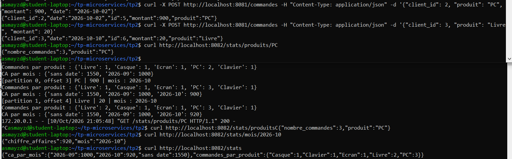

On n'a rien eu à changer dans clients pour ajouter ce service, et dans commandes on a seulement ajouté la date. C'est l'intérêt du découplage avec Kafka.

## 8. Kafka et groupes de consommateurs

### Deux consommateurs dans le même groupe

On a lancé deux conteneurs à partir de l'image de clients, dans le groupe `groupe-A` :

```bash
docker run -d --name conso-a1 --network tp2_default \
  -e KAFKA_BOOTSTRAP=kafka:9092 -e GROUP_ID=groupe-A tp2-clients
docker run -d --name conso-a2 --network tp2_default \
  -e KAFKA_BOOTSTRAP=kafka:9092 -e GROUP_ID=groupe-A tp2-clients

docker exec kafka /opt/kafka/bin/kafka-consumer-groups.sh --describe \
  --group groupe-A --bootstrap-server localhost:9092
```

Kafka a donné une partition à chacun : la partition 0 à conso-a1 et la partition 1 à conso-a2 (deux CONSUMER-ID différents).

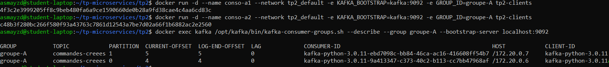

On a ensuite envoyé trois commandes : Stylo (Alex, partition 0), Sac (Alice, partition 1) et Lampe (Madeleine, partition 1). Stylo n'est reçu que par conso-a1, et Sac et Lampe que par conso-a2. Chaque message est traité une seule fois dans le groupe.

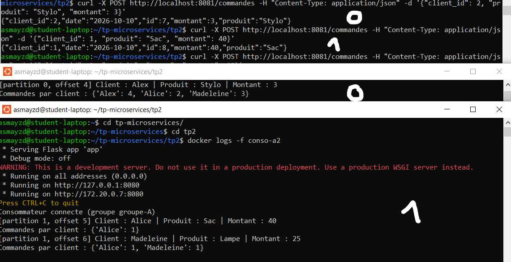

### Deux consommateurs dans des groupes différents

clients (`clients-group`) et statistiques (`statistiques-group`) ont tous les deux reçu les trois mêmes commandes, Stylo, Sac et Lampe.

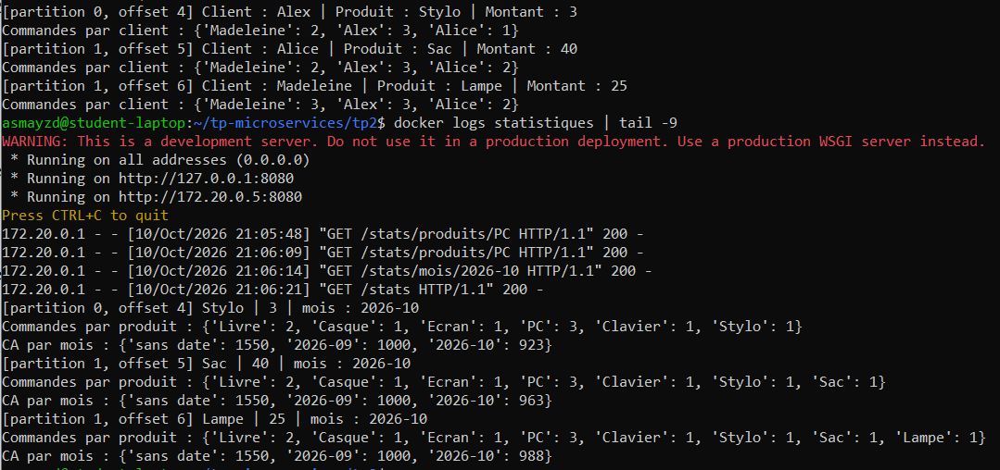

### Différence entre les deux configurations

- **Même groupe** : les consommateurs se partagent les partitions. Chaque partition est lue par un seul consommateur du groupe, donc chaque message n'est traité qu'une fois. C'est du partage de charge : s'il y a beaucoup de commandes, on peut ajouter des consommateurs dans le groupe.
- **Groupes différents** : chaque groupe reçoit tous les messages et garde son propre offset. Le même événement est traité une fois par groupe, ce qui permet à plusieurs services de réagir au même événement chacun à sa façon.

Dans un groupe les messages sont répartis, entre plusieurs groupes ils sont dupliqués. Le nombre de partitions limite le partage : avec 2 partitions, un troisième consommateur dans `groupe-A` n'aurait aucune partition et resterait inactif.

## Fichier docker-compose.yml complet

```yaml
services:
  kafka:
    image: apache/kafka:3.8.0
    container_name: kafka
    ports:
      - "9094:9094"
    environment:
      KAFKA_NODE_ID: 1
      KAFKA_PROCESS_ROLES: broker,controller
      KAFKA_LISTENERS: INTERNAL://:9092,EXTERNAL://:9094,CONTROLLER://:9093
      KAFKA_ADVERTISED_LISTENERS: INTERNAL://kafka:9092,EXTERNAL://localhost:9094
      KAFKA_LISTENER_SECURITY_PROTOCOL_MAP: INTERNAL:PLAINTEXT,EXTERNAL:PLAINTEXT,CONTROLLER:PLAINTEXT
      KAFKA_INTER_BROKER_LISTENER_NAME: INTERNAL
      KAFKA_CONTROLLER_LISTENER_NAMES: CONTROLLER
      KAFKA_CONTROLLER_QUORUM_VOTERS: 1@kafka:9093
      KAFKA_OFFSETS_TOPIC_REPLICATION_FACTOR: 1
      KAFKA_TRANSACTION_STATE_LOG_REPLICATION_FACTOR: 1
      KAFKA_TRANSACTION_STATE_LOG_MIN_ISR: 1
      KAFKA_NUM_PARTITIONS: 2

  commandes:
    build: ./commandes
    container_name: commandes
    ports:
      - "8081:8080"
    environment:
      KAFKA_BOOTSTRAP: kafka:9092
    depends_on:
      - kafka

  clients:
    build: ./clients
    container_name: clients
    ports:
      - "8080:8080"
    environment:
      KAFKA_BOOTSTRAP: kafka:9092
    depends_on:
      - kafka

  statistiques:
    build: ./statistiques
    container_name: statistiques
    ports:
      - "8082:8080"
    environment:
      KAFKA_BOOTSTRAP: kafka:9092
    depends_on:
      - kafka
```

Les trois services utilisent le même Dockerfile qu'au TP1.

## Sources

- Image Docker officielle Apache Kafka : https://hub.docker.com/r/apache/kafka
- Guide d'utilisation de l'image Docker (exemples Docker Compose) : https://github.com/apache/kafka/blob/trunk/docker/examples/README.md
- Configuration des listeners Kafka avec Docker (Confluent) : https://docs.confluent.io/platform/current/kafka/multi-node.html
