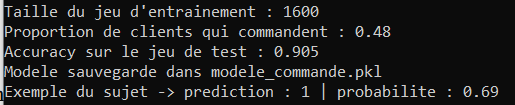
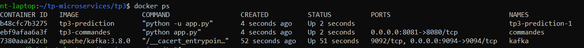
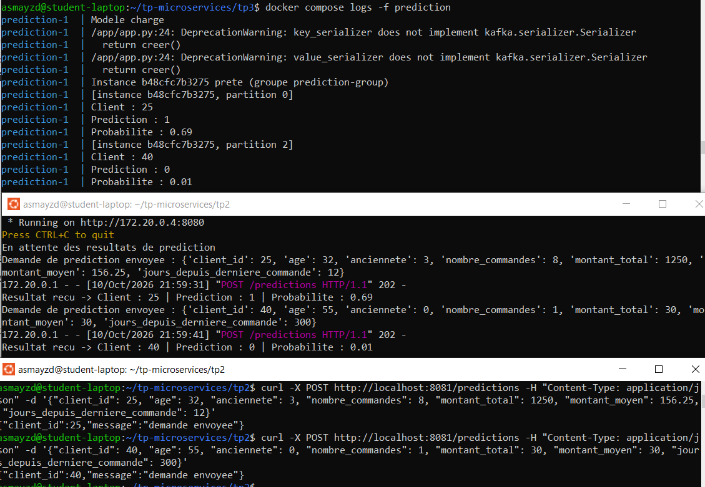
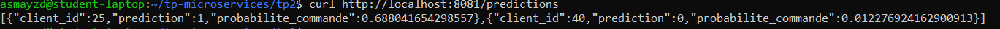
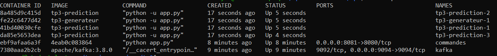
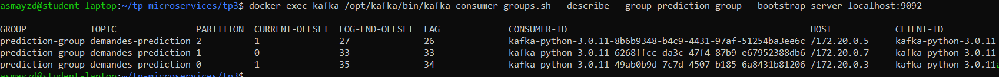
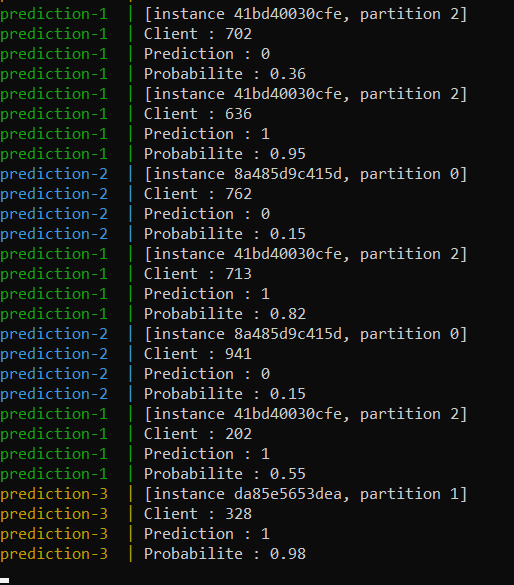
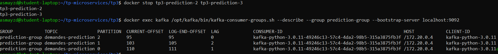
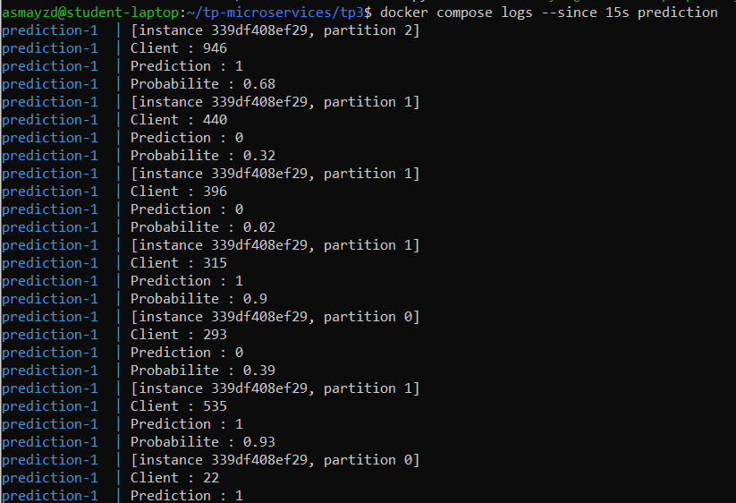

# TP3 - Microservice de prédiction

On reprend Kafka et le service commandes du TP2, et on ajoute un microservice prediction qui utilise un modèle de Machine Learning pour estimer la probabilité qu'un client passe une commande.

## Architecture

```
utilisateur --POST /predictions--> [ commandes ] --demandes-prediction--> [ Kafka ] --> [ prediction ]
                                         ^                                                    |
                                         +--------------- resultats-predictions <-------------+
```

- commandes publie les caractéristiques d'un client dans le topic `demandes-prediction`.
- prediction lit ce topic, fait la prédiction avec le modèle, et publie le résultat dans `resultats-predictions`.
- commandes lit `resultats-predictions` et affiche le résultat.

Tout tourne dans Docker, lancé avec un seul `docker-compose.yml`.

## 3.1 Préparer le modèle de Machine Learning

Le sujet ne fournit pas de données historiques, donc on en a simulé : 2000 clients fictifs avec les mêmes caractéristiques que dans le sujet. La cible (le client commande ou non) est calculée avec une règle simple plus du bruit aléatoire : un client commande plus souvent s'il a beaucoup de commandes, s'il est ancien et si sa dernière commande est récente.

On a utilisé une Random Forest, un des modèles proposés par le sujet. Elle donne aussi une probabilité avec `predict_proba`. `max_depth=6` limite la profondeur des arbres pour que le modèle n'apprenne pas le bruit par cœur.

`prediction/entrainement.py` :

```python
import numpy as np
import pandas as pd
import joblib
from sklearn.ensemble import RandomForestClassifier
from sklearn.model_selection import train_test_split
from sklearn.metrics import accuracy_score

# données historiques simulées (le sujet n'en fournit pas)
rng = np.random.default_rng(42)
n = 2000

nombre_commandes = rng.integers(0, 31, n)
montant_moyen = rng.uniform(10, 300, n).round(2)

df = pd.DataFrame({
    "age": rng.integers(18, 71, n),
    "anciennete": rng.integers(0, 11, n),
    "nombre_commandes": nombre_commandes,
    "montant_total": (nombre_commandes * montant_moyen).round(2),
    "montant_moyen": montant_moyen,
    "jours_depuis_derniere_commande": rng.integers(0, 366, n)
})

# règle utilisée pour fabriquer la cible, avec du bruit
score = (0.2 * df["nombre_commandes"]
         + 0.3 * df["anciennete"]
         - 0.02 * df["jours_depuis_derniere_commande"]
         + rng.normal(0, 1, n))
y = (score > 1).astype(int)

X_train, X_test, y_train, y_test = train_test_split(df, y, test_size=0.2, random_state=42)

model = RandomForestClassifier(n_estimators=100, max_depth=6, random_state=42)
model.fit(X_train, y_train)

print("Taille du jeu d'entrainement :", len(X_train))
print("Proportion de clients qui commandent :", round(y.mean(), 2))
print("Accuracy sur le jeu de test :", round(accuracy_score(y_test, model.predict(X_test)), 3))

joblib.dump(model, "modele_commande.pkl")
print("Modele sauvegarde dans modele_commande.pkl")

# test sur l'exemple du sujet
exemple = pd.DataFrame([{
    "age": 32, "anciennete": 3, "nombre_commandes": 8,
    "montant_total": 1250, "montant_moyen": 156.25,
    "jours_depuis_derniere_commande": 12
}])
print("Exemple du sujet -> prediction :", model.predict(exemple)[0],
      "| probabilite :", round(model.predict_proba(exemple)[0][1], 2))
```

On a entraîné le modèle dans un conteneur Python 3.12, le même que celui du microservice. Un fichier `.pkl` dépend de la version de scikit-learn utilisée, donc ça évite les problèmes de version au chargement.

```bash
cd tp3/prediction
docker run --rm -v "$PWD":/app -w /app python:3.12-slim \
  sh -c "pip install -q -r requirements.txt && python entrainement.py"
```

Le modèle a une accuracy de 0,905 sur le jeu de test. Sur l'exemple du sujet, il prédit 1 avec une probabilité de 0,69.



### Apprentissage et prédiction

L'apprentissage se fait une seule fois, hors du microservice : `entrainement.py` construit le modèle à partir des données et l'enregistre dans `modele_commande.pkl`. Le microservice prediction charge juste ce fichier au démarrage et s'en sert pour prédire à chaque événement, sans jamais réentraîner. Entraîner prend du temps et demande toutes les données, alors que prédire est rapide et ne demande que les infos d'un client.

## 3.2 Le microservice prediction

```
prediction/
|
+-- app.py
+-- entrainement.py
+-- modele_commande.pkl
+-- requirements.txt
+-- Dockerfile
```

`requirements.txt`, comme dans le sujet :

```
kafka-python>=2.0.3
pandas
scikit-learn
joblib
```

`Dockerfile` :

```dockerfile
FROM python:3.12-slim
WORKDIR /app
COPY requirements.txt .
RUN pip install --no-cache-dir -r requirements.txt
COPY app.py modele_commande.pkl ./
CMD ["python", "-u", "app.py"]
```

On copie le modèle dans l'image mais pas `entrainement.py` : l'image sert uniquement à prédire.

`app.py` :

```python
import os
import json
import time
import joblib
import pandas as pd
from kafka import KafkaConsumer, KafkaProducer

KAFKA_BOOTSTRAP = os.environ.get("KAFKA_BOOTSTRAP", "localhost:9094")
TOPIC_DEMANDES = "demandes-prediction"
TOPIC_RESULTATS = "resultats-predictions"
GROUP_ID = os.environ.get("GROUP_ID", "prediction-group")
INSTANCE = os.environ.get("HOSTNAME", "?")

COLONNES = ["age", "anciennete", "nombre_commandes", "montant_total",
            "montant_moyen", "jours_depuis_derniere_commande"]

# le modèle est chargé une seule fois au démarrage
model = joblib.load("modele_commande.pkl")
print("Modele charge", flush=True)

def attendre_kafka(creer):
    while True:
        try:
            return creer()
        except Exception as e:
            print("Kafka pas encore disponible, nouvel essai dans 3 s...", e, flush=True)
            time.sleep(3)

consumer = attendre_kafka(lambda: KafkaConsumer(
    TOPIC_DEMANDES,
    bootstrap_servers=KAFKA_BOOTSTRAP,
    group_id=GROUP_ID,
    auto_offset_reset="earliest"
))
producer = attendre_kafka(lambda: KafkaProducer(
    bootstrap_servers=KAFKA_BOOTSTRAP,
    key_serializer=lambda k: str(k).encode("utf-8"),
    value_serializer=lambda v: json.dumps(v).encode("utf-8")
))
print(f"Instance {INSTANCE} prete (groupe {GROUP_ID})", flush=True)

for message in consumer:
    try:
        data = json.loads(message.value.decode("utf-8"))
    except (json.JSONDecodeError, UnicodeDecodeError):
        print("Message ignore (pas du JSON)", flush=True)
        continue

    manquants = [c for c in COLONNES + ["client_id"] if c not in data]
    if manquants:
        print("Message ignore, champs manquants :", manquants, flush=True)
        continue

    # 3.4 construire l'entrée du modèle
    X = pd.DataFrame([{c: data[c] for c in COLONNES}])

    # 3.5 prédiction
    prediction = model.predict(X)[0]
    probabilite = model.predict_proba(X)[0][1]

    print(f"[instance {INSTANCE}, partition {message.partition}]", flush=True)
    print("Client :", data["client_id"], flush=True)
    print("Prediction :", prediction, flush=True)
    print("Probabilite :", round(probabilite, 2), flush=True)

    # 3.6 publier le résultat
    resultat = {
        "client_id": data["client_id"],
        "prediction": int(prediction),
        "probabilite_commande": float(probabilite)
    }
    producer.send(TOPIC_RESULTATS, key=data["client_id"], value=resultat)
    producer.flush()
```

Ce service n'a pas d'API Flask : il ne fait que lire un topic et écrire dans un autre. On affiche aussi le nom de l'instance et la partition, ce qui sert pour la partie 3.7.

## 3.3 Format d'un événement

Dans commandes, on a ajouté une route `POST /predictions`. Elle vérifie que tous les champs sont présents, puis publie l'événement dans `demandes-prediction`, avec `client_id` comme clé. Elle répond 202 (*Accepted*) : la demande est acceptée, mais le résultat arrivera plus tard, de façon asynchrone.

Exemple d'événement envoyé (celui du sujet) :

```json
{
  "client_id": 25,
  "age": 32,
  "anciennete": 3,
  "nombre_commandes": 8,
  "montant_total": 1250,
  "montant_moyen": 156.25,
  "jours_depuis_derniere_commande": 12
}
```

## 3.4 et 3.5 Construire l'entrée et prédire

À partir de l'événement, prediction construit un DataFrame avec les 6 caractéristiques, dans le même ordre qu'à l'entraînement. Le modèle doit recevoir exactement les mêmes colonnes que celles avec lesquelles il a été entraîné.

```python
X = pd.DataFrame([{c: data[c] for c in COLONNES}])
prediction = model.predict(X)[0]
probabilite = model.predict_proba(X)[0][1]
```

`predict_proba(X)[0][1]` donne la probabilité de la classe 1, c'est-à-dire la probabilité que le client commande.

## 3.6 Produire un événement de prédiction

Le résultat est publié dans `resultats-predictions` :

```json
{
  "client_id": 25,
  "prediction": 1,
  "probabilite_commande": 0.69
}
```

On convertit avec `int()` et `float()`, car `predict` renvoie des types numpy que `json.dumps` ne sait pas sérialiser.

Dans commandes, un thread lit `resultats-predictions` et affiche chaque résultat reçu. La route `GET /predictions` renvoie les derniers résultats.

`commandes/app.py` :

```python
import os
import json
import time
import threading
from datetime import date
from flask import Flask, jsonify, request
from kafka import KafkaProducer, KafkaConsumer

app = Flask(__name__)

KAFKA_BOOTSTRAP = os.environ.get("KAFKA_BOOTSTRAP", "localhost:9094")
TOPIC_COMMANDES = "commandes-creees"
TOPIC_DEMANDES = "demandes-prediction"
TOPIC_RESULTATS = "resultats-predictions"

CHAMPS_PREDICTION = ["client_id", "age", "anciennete", "nombre_commandes",
                     "montant_total", "montant_moyen", "jours_depuis_derniere_commande"]

commandes = [
    {"id": 1, "client_id": 1, "produit": "PC", "montant": 1200},
    {"id": 2, "client_id": 2, "produit": "Livre", "montant": 30},
    {"id": 3, "client_id": 1, "produit": "Casque", "montant": 80}
]

# derniers résultats de prédiction reçus, par client
resultats = {}

def attendre_kafka(creer):
    while True:
        try:
            return creer()
        except Exception as e:
            print("Kafka pas encore disponible, nouvel essai dans 3 s...", e, flush=True)
            time.sleep(3)

producer = attendre_kafka(lambda: KafkaProducer(
    bootstrap_servers=KAFKA_BOOTSTRAP,
    key_serializer=lambda k: str(k).encode("utf-8"),
    value_serializer=lambda v: json.dumps(v).encode("utf-8")
))

def ecouter_resultats():
    consumer = attendre_kafka(lambda: KafkaConsumer(
        TOPIC_RESULTATS,
        bootstrap_servers=KAFKA_BOOTSTRAP,
        group_id="commandes-group",
        auto_offset_reset="earliest"
    ))
    print("En attente des resultats de prediction", flush=True)
    for message in consumer:
        evt = json.loads(message.value.decode("utf-8"))
        resultats[evt["client_id"]] = evt
        print(f"Resultat recu -> Client : {evt['client_id']} | "
              f"Prediction : {evt['prediction']} | "
              f"Probabilite : {round(evt['probabilite_commande'], 2)}", flush=True)

@app.route("/commandes", methods=["GET"])
def get_commandes():
    return jsonify(commandes)

@app.route("/commandes/<int:commande_id>", methods=["GET"])
def get_commande(commande_id):
    for c in commandes:
        if c["id"] == commande_id:
            return jsonify(c)
    return jsonify({"erreur": "Commande introuvable"}), 404

@app.route("/commandes", methods=["POST"])
def creer_commande():
    data = request.get_json()
    if not data or not all(k in data for k in ("client_id", "produit", "montant")):
        return jsonify({"erreur": "client_id, produit et montant sont obligatoires"}), 400
    commande = {
        "id": len(commandes) + 1,
        "client_id": data["client_id"],
        "produit": data["produit"],
        "montant": data["montant"],
        "date": data.get("date", date.today().isoformat())
    }
    commandes.append(commande)
    evenement = {
        "commande_id": commande["id"],
        "client_id": commande["client_id"],
        "produit": commande["produit"],
        "montant": commande["montant"],
        "date": commande["date"]
    }
    producer.send(TOPIC_COMMANDES, key=commande["client_id"], value=evenement)
    producer.flush()
    return jsonify(commande), 201

# 3.3 envoyer une demande de prédiction
@app.route("/predictions", methods=["POST"])
def demander_prediction():
    data = request.get_json()
    if not data or not all(k in data for k in CHAMPS_PREDICTION):
        return jsonify({"erreur": "champs obligatoires : " + ", ".join(CHAMPS_PREDICTION)}), 400
    evenement = {k: data[k] for k in CHAMPS_PREDICTION}
    producer.send(TOPIC_DEMANDES, key=data["client_id"], value=evenement)
    producer.flush()
    print("Demande de prediction envoyee :", evenement, flush=True)
    return jsonify({"message": "demande envoyee", "client_id": data["client_id"]}), 202

@app.route("/predictions", methods=["GET"])
def get_predictions():
    return jsonify(list(resultats.values()))

if __name__ == "__main__":
    threading.Thread(target=ecouter_resultats, daemon=True).start()
    port = int(os.environ.get("PORT", 8080))
    app.run(host="0.0.0.0", port=port)
```

### Lancement et test

On arrête d'abord le TP2, qui utilise les mêmes noms de conteneurs. On démarre Kafka seul, on crée les deux topics, puis on lance le reste. Le topic des demandes a 3 partitions pour pouvoir avoir jusqu'à 3 instances de prediction en parallèle (voir 3.7).

```bash
cd tp2 && docker compose down
cd ../tp3
docker compose up -d kafka
docker exec kafka /opt/kafka/bin/kafka-topics.sh --create --topic demandes-prediction \
  --partitions 3 --replication-factor 1 --bootstrap-server localhost:9092
docker exec kafka /opt/kafka/bin/kafka-topics.sh --create --topic resultats-predictions \
  --partitions 2 --replication-factor 1 --bootstrap-server localhost:9092
docker compose up -d --build
docker ps
```



On a envoyé deux demandes : l'exemple du sujet (client 25) et un client qui a peu de chances de commander (client 40 : ancienneté 0, une seule commande, dernière commande il y a 300 jours).

```bash
curl -X POST http://localhost:8081/predictions -H "Content-Type: application/json" \
  -d '{"client_id": 25, "age": 32, "anciennete": 3, "nombre_commandes": 8, "montant_total": 1250, "montant_moyen": 156.25, "jours_depuis_derniere_commande": 12}'
curl -X POST http://localhost:8081/predictions -H "Content-Type: application/json" \
  -d '{"client_id": 40, "age": 55, "anciennete": 0, "nombre_commandes": 1, "montant_total": 30, "montant_moyen": 30, "jours_depuis_derniere_commande": 300}'
```

prediction a traité les deux demandes (client 25 : prédiction 1, probabilité 0,69 ; client 40 : prédiction 0, probabilité 0,01), et commandes a bien reçu et affiché les deux résultats. On voit aussi que les deux demandes sont arrivées sur des partitions différentes (0 et 2), à cause de leur clé `client_id`.



Les résultats sont aussi disponibles avec `GET /predictions` :



## 3.7 Questions avancées

### Dockeriser l'application

Tous les services sont dockerisés et lancés avec Docker Compose (fichier complet à la fin).

### Flux infini de demandes et K instances

Pour simuler un flux infini, on a ajouté un service `generateur` qui envoie une demande toutes les 0,5 seconde dans `demandes-prediction`, avec des clients aléatoires (`client_id` entre 1 et 1000).

`generateur/app.py` :

```python
import os
import json
import time
import random
from kafka import KafkaProducer

KAFKA_BOOTSTRAP = os.environ.get("KAFKA_BOOTSTRAP", "localhost:9094")
TOPIC = "demandes-prediction"
DELAI = float(os.environ.get("DELAI", "0.5"))  # secondes entre deux demandes

def attendre_kafka(creer):
    while True:
        try:
            return creer()
        except Exception as e:
            print("Kafka pas encore disponible, nouvel essai dans 3 s...", e, flush=True)
            time.sleep(3)

producer = attendre_kafka(lambda: KafkaProducer(
    bootstrap_servers=KAFKA_BOOTSTRAP,
    key_serializer=lambda k: str(k).encode("utf-8"),
    value_serializer=lambda v: json.dumps(v).encode("utf-8")
))

compteur = 0
while True:
    nombre_commandes = random.randint(0, 30)
    montant_moyen = round(random.uniform(10, 300), 2)
    demande = {
        "client_id": random.randint(1, 1000),
        "age": random.randint(18, 70),
        "anciennete": random.randint(0, 10),
        "nombre_commandes": nombre_commandes,
        "montant_total": round(nombre_commandes * montant_moyen, 2),
        "montant_moyen": montant_moyen,
        "jours_depuis_derniere_commande": random.randint(0, 365)
    }
    producer.send(TOPIC, key=demande["client_id"], value=demande)
    compteur += 1
    if compteur % 20 == 0:
        print(f"{compteur} demandes envoyees", flush=True)
    time.sleep(DELAI)
```

Le nombre d'instances de prediction est un paramètre K, passé au lancement grâce à `deploy.replicas: ${K:-1}` dans le `docker-compose.yml` :

```bash
K=3 docker compose up -d --build
docker ps
```

On a bien 3 instances de prediction (`tp3-prediction-1` à `-3`) et le générateur :



Les 3 instances sont dans le même groupe `prediction-group`, donc Kafka donne une partition à chacune (3 CONSUMER-ID différents). Cette capture a été prise juste après le démarrage : le générateur avait déjà envoyé des demandes avant que les instances soient prêtes, d'où le LAG élevé. Les instances rattrapent ensuite ce retard.

```bash
docker exec kafka /opt/kafka/bin/kafka-consumer-groups.sh --describe \
  --group prediction-group --bootstrap-server localhost:9092
```



Dans les logs, chaque instance traite sa propre partition : prediction-1 la partition 2, prediction-2 la partition 0 et prediction-3 la partition 1.



On ne peut pas avoir plus d'instances actives que de partitions. Avec K = 4 et 3 partitions, une instance resterait inactive. Pour aller plus loin, il faudrait d'abord augmenter le nombre de partitions du topic (`kafka-topics.sh --alter --partitions 6`). On peut en ajouter, mais pas en retirer.

### Résilience à la panne

Avec le générateur toujours actif, on a arrêté une instance, puis une deuxième :

```bash
docker stop tp3-prediction-2
docker stop tp3-prediction-3
```

Lors d'un premier essai, on a lancé le `--describe` tout de suite après l'arrêt : Kafka affichait que le groupe était en cours de rééquilibrage, sans aucun consommateur, et le LAG augmentait puisque le générateur continuait d'envoyer des demandes.

Une fois le rééquilibrage terminé, le groupe n'a plus qu'un seul consommateur : le même CONSUMER-ID apparaît sur les 3 partitions, et le LAG reste proche de 0.



Dans les logs, seule prediction-1 apparaît, et elle traite maintenant les partitions 0, 1 et 2. Le service continue de fonctionner, simplement avec moins de capacité.



Ce qu'on retient :

- Aucune demande n'est perdue : les messages restent dans Kafka, et l'offset du groupe indique où reprendre. Le LAG monte un peu pendant la répartition, puis redescend.
- La répartition n'est pas instantanée : Kafka attend environ 10 secondes (le *session timeout*) avant de considérer qu'une instance est morte. Pendant ce temps, sa partition n'est pas traitée.
- Quelques demandes peuvent être traitées deux fois. L'offset est enregistré automatiquement toutes les 5 secondes, donc si une instance s'arrête entre deux enregistrements, celle qui reprend sa partition retraite les derniers messages. Kafka garantit "au moins une fois", pas "exactement une fois". Pour une prédiction ce n'est pas grave : le résultat est le même.

Après `docker start tp3-prediction-2 tp3-prediction-3`, Kafka redistribue les partitions entre les 3 instances.

### Montée en charge

Le microservice prediction ne garde aucun état : il charge le modèle au démarrage et traite chaque demande indépendamment. On peut donc lancer autant d'instances que nécessaire avec K, et Kafka répartit les partitions entre elles.

Kafka sert aussi de tampon : si les demandes arrivent plus vite qu'elles ne sont traitées, elles s'accumulent dans le topic sans être perdues. Le LAG du groupe `prediction-group` mesure ce retard. S'il augmente en continu, il faut ajouter des instances.

La limite est le nombre de partitions : au-delà, les instances en plus restent inactives. Il faut donc prévoir assez de partitions dès le départ. On pourrait aussi faire les prédictions par lots (plusieurs demandes dans un seul `predict`) pour aller plus vite, et en production un outil comme Kubernetes pourrait ajuster automatiquement le nombre d'instances en fonction du LAG.

## Fichier docker-compose.yml complet

```yaml
services:
  kafka:
    image: apache/kafka:3.8.0
    container_name: kafka
    ports:
      - "9094:9094"
    environment:
      KAFKA_NODE_ID: 1
      KAFKA_PROCESS_ROLES: broker,controller
      KAFKA_LISTENERS: INTERNAL://:9092,EXTERNAL://:9094,CONTROLLER://:9093
      KAFKA_ADVERTISED_LISTENERS: INTERNAL://kafka:9092,EXTERNAL://localhost:9094
      KAFKA_LISTENER_SECURITY_PROTOCOL_MAP: INTERNAL:PLAINTEXT,EXTERNAL:PLAINTEXT,CONTROLLER:PLAINTEXT
      KAFKA_INTER_BROKER_LISTENER_NAME: INTERNAL
      KAFKA_CONTROLLER_LISTENER_NAMES: CONTROLLER
      KAFKA_CONTROLLER_QUORUM_VOTERS: 1@kafka:9093
      KAFKA_OFFSETS_TOPIC_REPLICATION_FACTOR: 1
      KAFKA_TRANSACTION_STATE_LOG_REPLICATION_FACTOR: 1
      KAFKA_TRANSACTION_STATE_LOG_MIN_ISR: 1
      KAFKA_NUM_PARTITIONS: 2

  commandes:
    build: ./commandes
    container_name: commandes
    ports:
      - "8081:8080"
    environment:
      KAFKA_BOOTSTRAP: kafka:9092
    depends_on:
      - kafka

  prediction:
    build: ./prediction
    environment:
      KAFKA_BOOTSTRAP: kafka:9092
    depends_on:
      - kafka
    deploy:
      replicas: ${K:-1}

  generateur:
    build: ./generateur
    environment:
      KAFKA_BOOTSTRAP: kafka:9092
      DELAI: "0.5"
    depends_on:
      - kafka
```

Le service prediction n'a pas de `container_name` ni de port : un nom fixe empêcherait de lancer plusieurs instances, et il n'a pas d'API à exposer.
